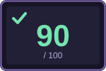
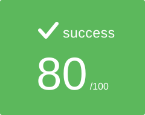
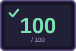
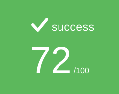
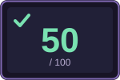
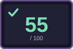
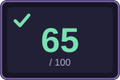
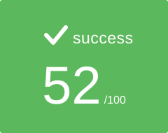

<div align="center">

# 🏊 42 Piscine — Angoulême

  

  

</div>

## 📖 About

This repository gathers my whole **42 Angoulême Piscine** journey: an intensive four-week selection bootcamp where you learn C and Unix from scratch, with no teachers, no lectures, only peer-learning, peer-evaluation and a strict coding norm.

Every exercise here was written by hand, checked by **Moulinette** (42's automated grader), reviewed by fellow pisciners and kept compliant with the **Norminette**. I passed the Piscine and was admitted to the 42 cursus. 🎉

## 📝 Exams

<div align="center">
<table>
  <tr>
    <th align="center">Exam 00</th>
    <th align="center">Exam 01</th>
    <th align="center">Exam 02</th>
    <th align="center">Final Exam</th>
  </tr>
  <tr>
    <td align="center" valign="middle"></td>
    <td align="center" valign="middle"></td>
    <td align="center" valign="middle"></td>
    <td align="center" valign="middle"></td>
  </tr>
</table>
</div>

## 📅 Days

| Day | Topic | Grade |
|:---:|:---|:---:|
| [**Shell00**](S00) | Unix basics: files, permissions, archives, `ls`, `find` and first steps with Git. |  |
| [**Shell01**](S01) | Shell scripting with environment variables, pipes, `sed`/`tr` and base conversion. |  |
| [**C00**](C00) | First C programs: `write`, characters, digits and printing combinations. |  |
| [**C01**](C01) | Pointers: addresses, swapping values, division/modulo and integer arrays. |  |
| [**C02**](C02) | String manipulation: copy, character checks, case conversion and capitalization. |  |
| [**C03**](C03) | String comparison, concatenation and substring search (`strcmp`, `strcat`, `strstr`). |  |
| [**C04**](C04) | Number ↔ string conversion: `putnbr`, `atoi` and custom bases. |  |
| [**C05**](C05) | Recursion and math: factorial, power, Fibonacci, square root, primes and the ten queens. |  |
| [**C06**](C06) | Command-line arguments with `argc` / `argv`: printing, reversing and sorting them. |  |
| [**C07**](C07) | Dynamic memory with `malloc`: `strdup`, ranges, `strjoin`, base conversion and `split`. |  |
| [**C08**](C08) | Header files, macros and structures. |  |
| [**C09**](C09) | Building a static library (`libft.a`) and writing a Makefile. |  |
| [**C11**](C11) | Function pointers: `foreach`, `map`, `count_if`, sort checks and `do-op`. |  |

> 🧩 Also in this repo: [**BSQ**](BSQ), the final Piscine project (find the biggest square on a map).

## 🗂️ Repository structure

```text
42_piscine/
├── S00/  S01/        # Shell days
├── C00/ … C09/  C11/ # C days
├── BSQ/              # Final project
└── assets/grades/    # Grade badges used in this README
```

## 🏆 Final words

A huge thank you to the 42 Angoulême staff and to every pisciner I shared the cluster with. The peer evaluations, the late-night debugging sessions and the Friday exam pressure made this month the most intense and the most fun I've ever had coding. I came out of it **boosted**, and I loved every second of it. 💚

Honestly, the whole Piscine felt like the **Hunter Exam** 🎣⚡: a month of trials, candidates dropping out round after round, Moulinette judging you with zero mercy... and at the end, the license. Gon and Killua made it through theirs, I made it through mine. See you in the common core! 🚀

<div align="center">

**Made with ☕, 💚 and a lot of segfaults by [1soka](https://github.com/1soka)**

</div>
